# Edu · 轻量级 AI 教学服务

把 **DeepTutor** 的个性化辅导与掌握度，和 **OpenMAIC** 的课堂生成与互动，合成一个 **Python + Vue3** 的单进程应用。

学生端：上传讲义 → 向 AI 导师提问（带出处）→ 一键生成可交互课堂 → 随堂测验 → 看到每个知识点的掌握度。
教师端：登录 → 建班 → 发邀请码 → 布置随堂测验与课后作业 → 看提交进度和错题分布 → 导出学生报告。

不需要单独的数据库服务、没有向量库、没有独立前端服务器，双击 `start.bat` 即可使用
（数据落在一个 `data/edu.sqlite3` 文件里）。

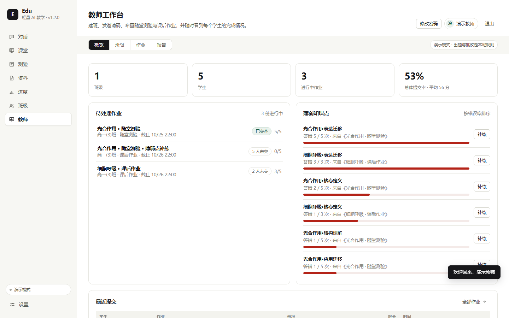

## 目录

- [两个项目的优势如何合并](#两个项目的优势如何合并)
- [功能一览](#功能一览)
- [快速开始](#快速开始)
- [教师工作台使用指南](#教师工作台使用指南)
  - [登录与账号](#登录与账号)
  - [建班与邀请码](#建班与邀请码)
  - [布置随堂测验与课后作业](#布置随堂测验与课后作业)
  - [查看进度与错题](#查看进度与错题)
  - [薄弱点补练](#薄弱点补练)
  - [导出学生报告](#导出学生报告)
  - [学生端怎么用](#学生端怎么用)
- [配置模型](#配置模型)
- [目录结构](#目录结构)
- [数据与备份](#数据与备份)
- [HTTP API](#http-api)
- [设计说明](#设计说明)
- [常见问题](#常见问题)
- [验证情况](#验证情况)
- [致谢与许可](#致谢与许可)

## 两个项目的优势如何合并

| 能力 | 来源 | 在 Edu 中的实现 |
| --- | --- | --- |
| 苏格拉底式一对一辅导 | DeepTutor | `/api/chat/stream`，先给线索再追问，支持「引导 / 讲解」两种模式 |
| 资料检索与出处标注 | DeepTutor | 上传讲义后分块建索引，BM25 + 向量混合检索（RRF 融合，可选 LLM 重排），回答中用 `[1]` 标注来源并给出段落号 |
| 掌握度与薄弱点建议 | DeepTutor | 近期表现加权 + 证据不足时的置信上限，进度页给出下一步建议 |
| 一键生成完整课堂 | OpenMAIC | 一次生成「开场 → 讲解 → 讨论 → 检测 → 回顾」的课堂 JSON |
| 课堂对话与 PPT 导出 | OpenMAIC | 与 AI 老师围绕当前页连续追问；导出教师版 PPTX，讲解词进备注、答案进附录 |
| 小组互动（多智能体） | OpenMAIC + 本项目 | 角色存在存储层的 `agents`（默认值来自 `server/default_agents.json`），可增删改；主持人 Agent 按当前页与讨论内容选人、分配焦点，真实学生参与讨论 |
| 随堂测验与逐题解析 | OpenMAIC | 客观题 + 简答题，提交后逐题反馈并写入掌握度 |
| 举一反三变式练习 | 本项目 | 按错题知识点再生成同难度题目，练习模式直接带详解 |
| 班级与邀请码 | 本项目（v1.2） | 教师建班生成 6 位邀请码，学生输码 + 姓名即可加入，无需注册 |
| 作业布置与提交 | 本项目（v1.2） | 教师按主题出题发给班级；学生端看到任务、作答、交卷，成绩自动回传 |
| 班级进度与错题统计 | 本项目（v1.2） | 提交率、未交名单、每题错误率、知识点错误率，支持一键补练 |
| 学生报告导出 | 本项目（v1.2） | 班级成绩报告（HTML 图表看板）、班级成绩 CSV、作业明细 CSV、学生个人 HTML 报告 |
| 实时推送 | 本项目（v1.3） | 学生进班、交卷、老师布置作业都是一个 SSE 事件，对端无需刷新自动更新，并给出提示 |
| 文件作业与 AI 批改 | 本项目（v1.4） | 学生上传 PDF / Word / PPT / 文本 / 图片，AI 初评，教师可下载、复核改分 |
| 名单导入与学号登录 | 本项目（v1.5） | 教师导入教务名单，学生用学号 + 密码登录；支持重置密码与邀请码回退 |
| 极简、可运行的前端 | 本项目 | Vue 3 + 原生 CSS，纯色与细边框，无玻璃/模糊/渐变 |

> Edu 不是把两个 Next.js 项目拼在一起，而是提取它们的教学模型与交互范式，用 Python + Vue3 独立重写。仓库不包含上游项目代码；掌握度公式参考了 DeepTutor 公开的策略并重新实现。

## 功能一览

### 学生端

- **对话**：苏格拉底引导 / 系统讲解、资料范围可选、流式输出、引用出处、停止生成。
- **课堂**：按主题和难度生成 5–8 页课堂，含教师讲解词、课堂提问、讨论页和检测页；右侧可切换「答疑 / 小组」；工具栏有「导出 PPT」。
- **小组设置**：角色可增删、改名字/分工/提示词，保存后主持人立即按新配置选人。
- **测验**：按主题出题，支持单选和简答；提交后逐题显示作答、正确答案与解析，可继续「举一反三」。
- **资料**：上传 PDF / Word / Markdown / TXT，自动解析与分块，支持预览和删除。
- **拍题识别（P2）**：上传 JPG / PNG / WEBP 图片，本机 OCR 转成可编辑文字，一键存入资料库；低置信度行会单独标出，提示人工核对。
- **进度**：主题掌握度、知识点拆解、最近活动、薄弱点建议。
- **班级（v1.2）**：老师建班后生成邀请码；导入名单后学生改用**学号 + 密码**登录。
- **实时更新（v1.3）**：老师在课上布置作业，学生端几秒内自动出现新任务并弹出提示；断线后自动重连并补齐数据，不用手动刷新。
- **文件作业（v1.4）**：提交附件（PDF / Word / PPT / 文本 / 图片），AI 先给初评，老师复核后的分数计入成绩。
- **演示模式**：没有 API Key 也能完整走通流程，所有示例输出会明确标注为演示内容。

| 课堂答疑 | 小组互动 |
| --- | --- |
| 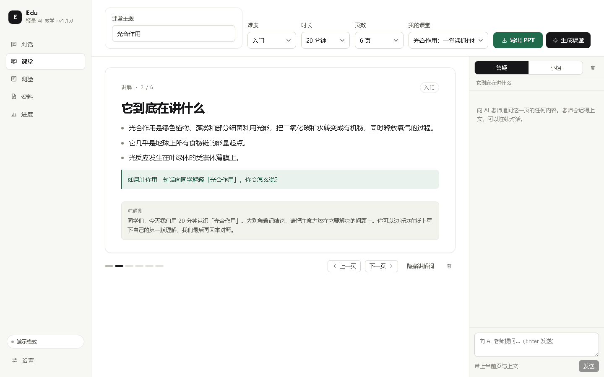 | 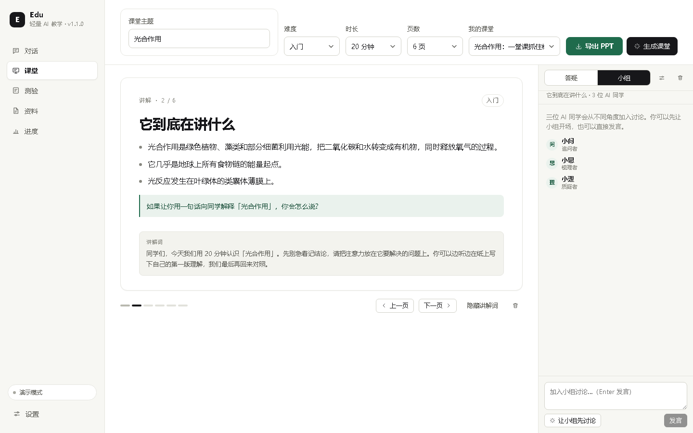 |

| 测验答案与详解 | 举一反三 |
| --- | --- |
| 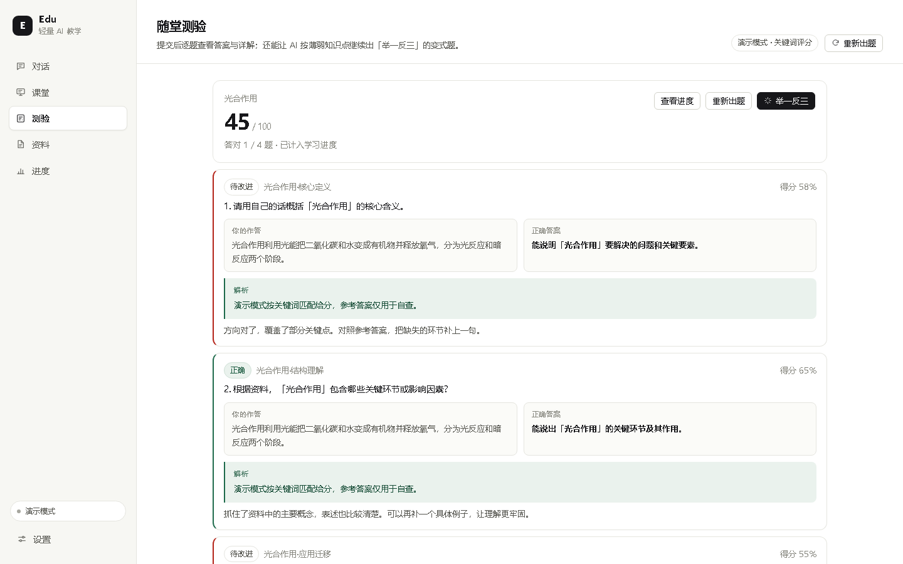 | 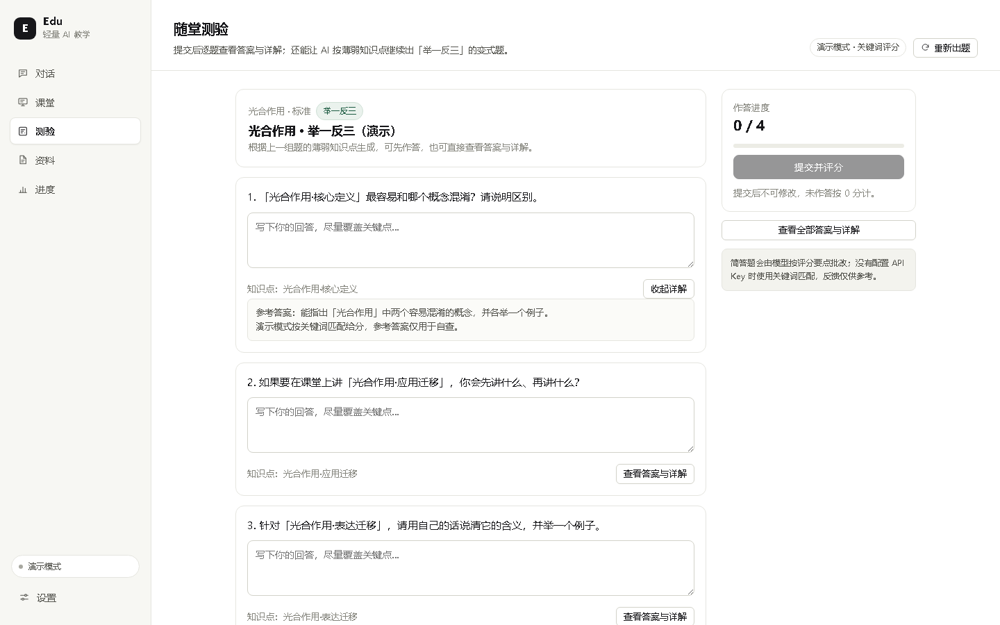 |

| 小组设置 | 学习进度 |
| --- | --- |
| 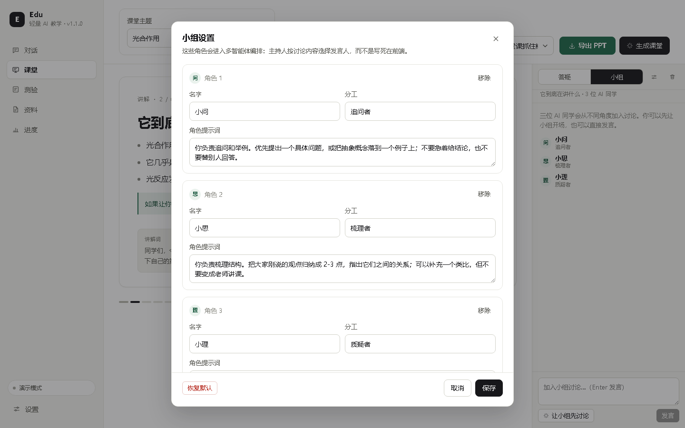 | 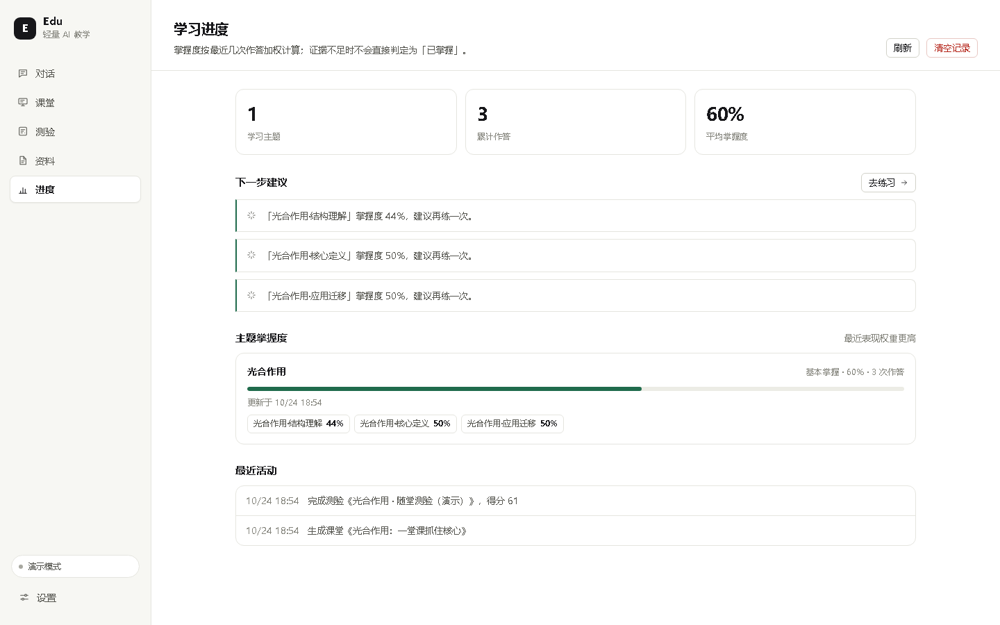 |

### 教师工作台（v1.2 新增）

一个面向教师的「小工作台」，侧边栏点「教师」进入。四个标签页：

| 标签 | 能做什么 |
| --- | --- |
| **概览** | 班级数、学生数、进行中作业、总体提交率；待处理作业（含未交人数）；薄弱知识点排行；最近提交 |
| **班级** | 新建班级、6 位邀请码、复制邀请链接、重置邀请码、学生名单、移除学生、归档、删除班级、导出成绩 |
| **作业** | 布置随堂测验 / 课后作业、按班级筛选、每份作业的提交率与平均分、关闭/重开、删除、导出明细 |
| **报告** | 按班级查看每个学生的完成率与平均分，一键导出班级成绩报告（HTML 图表看板）或学生个人 HTML 报告 |

页面顶部会显示「实时」标记：学生在「班级」页打开时，名单里名字前出现绿点，标题旁显示「N 人在线」；
学生加入班级、交卷会立即刷新概览 / 班级详情 / 作业统计，并弹出提示，不需要点刷新。

页头的「教研组（P2）」把单人工作台扩成备课组：建组后按用户名邀请同事，班级可以挂到组上。
组内老师能只读查看彼此的班级与报告，组长还能看分、管组；弹窗底部附最近 50 条审计记录（登录、改名、布置作业、改分、组变更等），普通教师看不到审计。

作业详情页还会给出：

- **提交进度**：已交 / 应交、提交率、班级平均分、未交学生名单。
- **错题分布**：每道题的已答人数、答错人数、错误率（答错 ÷ 已答），并按错误率排序。
- **知识点统计**：每个知识点的作答次数、答错次数、平均分与错误率。
- **薄弱点补练**：按错题知识点再生成同难度变式题，作为一份新作业直接发给班级。
- **学生成绩**：得分、答对题数、提交次数、提交时间；重复提交只保留最后一次。

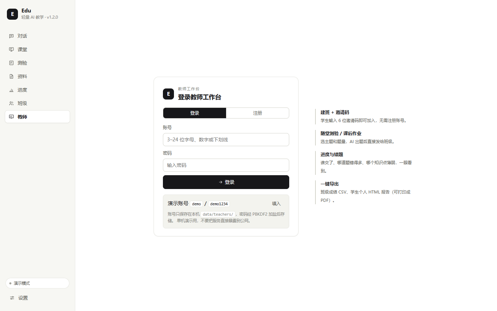

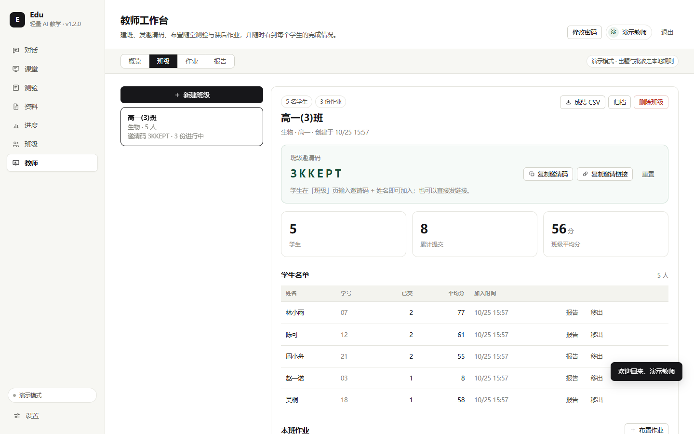

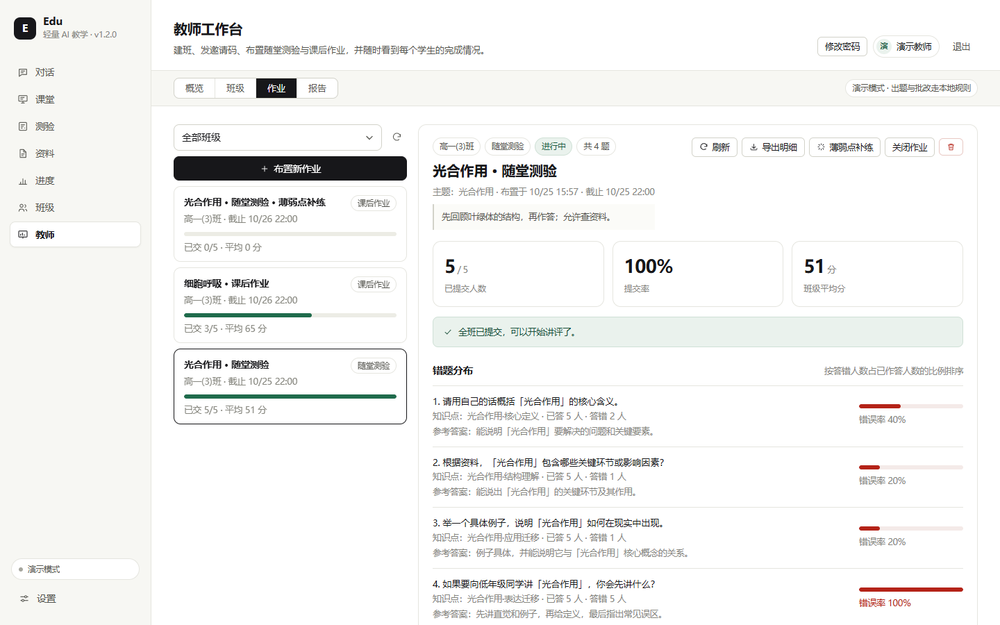

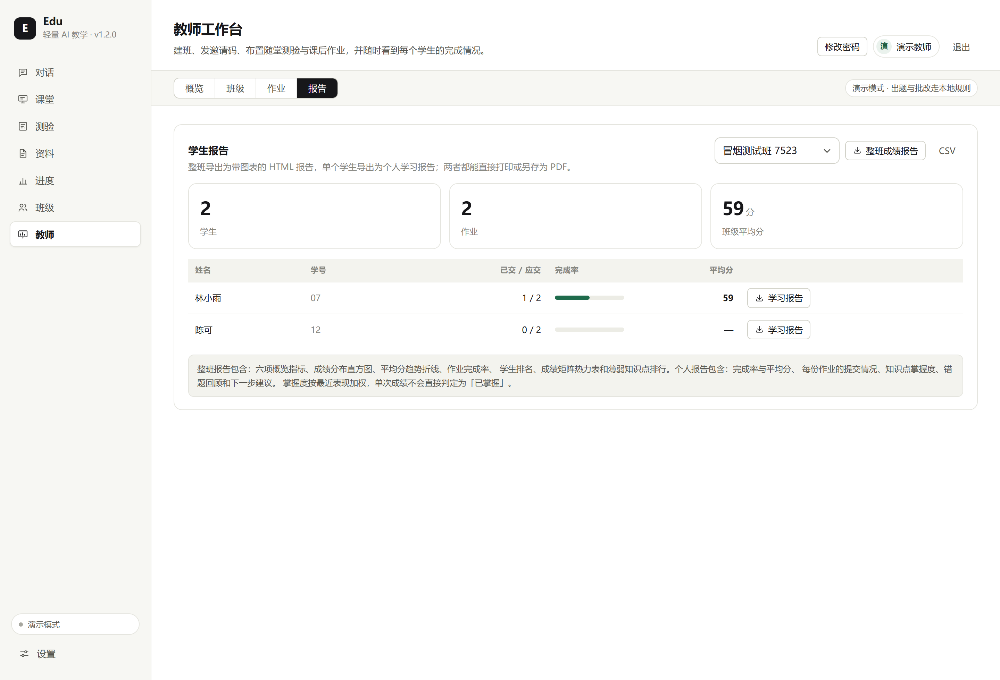

## 快速开始

### Windows

1. 安装 Python 3.10+（安装时勾选 “Add Python to PATH”）。
2. 双击 `start.bat`。
3. 首次启动会自动创建 `.venv`、安装依赖；完成后浏览器打开 <http://127.0.0.1:8000>。

### macOS / Linux

```bash
cd edu
chmod +x start.sh
./start.sh
```

> 前端已构建在 `web/dist`，因此**没有 Node.js 也能启动**。只有修改前端源码时才需要 Node 18+ 重新构建。
>
> 首次装依赖会多下载约 120 MB 的 OCR 运行时（`onnxruntime` + `rapidocr`）。不需要拍题识别的话，
> 可以从 `requirements.txt` 删掉最后三行，服务照常启动，只是 `/api/ocr/extract` 会返回 503。

启动脚本做了什么：

| 步骤 | 说明 |
| --- | --- |
| 找 Python | 依次尝试 `py -3`、`python`，低于 3.10 会提示 |
| 建虚拟环境 | 首次创建 `.venv`，之后复用 |
| 装依赖 | 首次安装 `requirements.txt`，成功后写入 `.venv/.deps-ok` 跳过 |
| 建前端 | 仅当 `web/dist/index.html` 不存在且本机有 npm 时执行 `npm install && npm run build` |
| 启动 | 运行 `python -m server.main`，自动选空闲端口并打开浏览器 |

手动启动（调试时）：

```bash
cd edu
.venv\Scripts\python -m server.main --port 8000
# macOS/Linux: .venv/bin/python -m server.main --port 8000
```

## 教师工作台使用指南

### 登录与账号

1. 侧边栏点 **教师**，进入登录页。
2. 首次启动会自动创建一个演示账号：

   | 账号 | 密码 |
   | --- | --- |
   | `demo` | `demo1234` |

   登录页的「填入」按钮可以一键填好，登录后建议在右上角「修改密码」里改掉。
3. 也可以切到「注册」创建自己的账号（3–24 位字母/数字/下划线，密码至少 6 位）。
4. 同一个数据目录可以注册多个教师账号，**各自只能看到自己创建的班级**。

实现方式：密码用 PBKDF2-SHA256 加盐（12 万次迭代）存在存储层的 `teachers` 集合里；登录态是服务端签发的 token，有效期 12 小时，重启服务后仍然有效。

> 这是单机演示用的轻量账号体系：没有邮箱验证、找回密码、角色权限。忘记密码需要删除 `teachers` 集合里的对应记录，重启服务后重新创建账号。

### 建班与邀请码

1. 进入 **班级** 标签，点「新建班级」，填班级名称（必填）、科目、年级。
2. 创建后自动生成一个 **6 位邀请码**（去掉了 `I/O/0/1` 这类易混字符），例如 `3KKEPT`。
3. 把邀请码或邀请链接发给学生：
   - **复制邀请码**：学生在「班级」页输入邀请码 + 姓名 + 学号（可选）即可加入。
   - **复制邀请链接**：形如 `http://127.0.0.1:8000/?join=3KKEPT`，学生打开后会自动跳到「班级」页并填好邀请码。
4. 班级卡片上会显示学生数、进行中作业数；右侧名单里能看到每个学生的已交份数与平均分。

其他操作：

| 操作 | 说明 |
| --- | --- |
| 重置邀请码 | 旧码立即失效，已加入的学生不受影响 |
| 归档 | 归档后不再接收新学生，历史数据保留；可随时恢复 |
| 删除班级 | 连同该班作业、学生、提交记录一起删除，不可恢复 |
| 移出学生 | 删除该学生在这个班的提交记录，其他班不受影响 |

学生识别方式：**邀请码 + 姓名 + 学号**。同名同姓的学生请用学号区分；同一姓名 + 学号再次加入会复用原档案，所以换设备重新输入也能看到之前的成绩。

### 布置随堂测验与课后作业

1. 进入 **作业** 标签，点「布置新作业」（或班级详情里的「布置作业」）。
2. 填写：

   | 字段 | 说明 |
   | --- | --- |
   | 班级 | 作业发给哪个班 |
   | 类型 | 随堂测验 / 课后作业（只影响标签与默认场景，不改变出题逻辑） |
   | 作业主题 | AI 围绕它出题，例如「光合作用的两个阶段」 |
   | 显示标题 | 可选，留空则使用 AI 生成的标题 |
   | 题量 | 3–8 题 |
   | 难度 | 基础 / 标准 / 挑战 |
   | 截止时间 | 可选；支持「今晚 22:00 / 明天 20:00 / 一周后 / 不设截止」快捷按钮 |
   | 给学生的说明 | 可选，显示在学生作答页顶部 |
   | 交卷后显示解析 | 默认开启；关闭后学生只看到对错与得分，看不到正确答案 |

3. 点「布置作业」，题目生成后立即出现在学生端的「班级」页，无需再单独通知。

出题会优先检索资料库中的相关内容；资料不足时基于通用知识出题。**演示模式**（未配置 API Key）下会用本地规则生成简答题，判分使用关键词匹配，方便先走通完整流程。

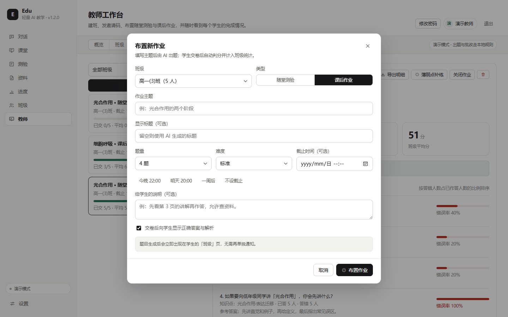

### 查看进度与错题

- **概览** 页的「待处理作业」按截止时间排序，直接显示「几 人未交」；点一行跳到作业详情。
- **作业** 标签左侧列出全部作业，每张卡片带提交率进度条和平均分；点开右侧是详情。
- 详情里可以看到：
  - 已交 / 应交、提交率、平均分；
  - 未提交学生名单（或「全班已提交」）；
  - **错题分布**：每题的已答人数、答错人数、错误率，错误率 ≥ 50% 会标红；
  - **知识点统计**：按错误率排序，便于决定下一节课讲什么；
  - **学生成绩**：得分、答对题数、提交次数、提交时间。
- 作业可以随时「关闭作业」（学生不能再提交）或「重新开放」。

提交率、错误率等统计都在服务端按提交记录实时计算，不依赖前端缓存。

### 薄弱点补练

有两种入口：

1. 作业详情右上角的「薄弱点补练」——自动取错误率最高的 3 个知识点；
2. 「知识点统计」里的「按薄弱点补练」——取错误率最高的 4 个知识点。

补练会基于原作业生成同难度的变式题，作为一份新的课后作业布置给同一个班级，默认交卷后显示答案解析，适合讲评后立刻巩固。

### 导出学生报告

| 导出 | 入口 | 内容 |
| --- | --- | --- |
| **班级成绩报告 HTML** | 班级详情「成绩报告」/ 报告页「整班成绩报告」 | 整班数据看板，含六项概览指标、成绩分布直方图、平均分趋势折线、作业完成率、学生排名、成绩矩阵热力表、薄弱知识点排行和要点提示 |
| 班级成绩 CSV | 报告页「CSV」 | 每行一个学生，每列一份作业的得分（未交标注为「未交」），附提交数、应交数、平均分 |
| 作业明细 CSV | 作业详情「导出明细」 | 每个学生的得分、答对题数、提交次数、提交时间，以及每题的对错（√ / × / 未答） |
| 学生报告 HTML | 班级名单 / 报告页的「学习报告」 | 个人完整报告：总体表现、作业明细、知识点掌握度、错题回顾、下一步建议 |

班级成绩报告是整班导出时最常用的一个，打开就能看到班级整体情况：

| 板块 | 看什么 |
| --- | --- |
| 概览指标 | 学生人数、作业份数、提交率、班级平均分、最高均分、最低均分（低于 60 标红） |
| 成绩分布 | 按每位学生的平均得分分成 0-59 / 60-69 / 70-79 / 80-89 / 90-100 五档，柱高是人数，颜色从红到绿 |
| 平均分趋势 | 横轴是作业序号（和下方表格的「#」列对应），纵轴是全班平均分，看班级整体是往上走还是往下掉 |
| 作业完成情况 | 每份作业的提交人数、提交率条和平均分，一眼看出哪次作业大家没交 |
| 学生排名 | 按平均得分从高到低排，条长是分数，颜色分档；没有提交记录的学生单列说明 |
| 成绩矩阵 | 学生 × 作业的完整表格，单元格颜色由绿到红表示分数高低，「—」是未交 |
| 薄弱知识点 | 按错误率从高到低排，标出答错题数，直接对应下一节课该复习什么 |

CSV 使用 UTF-8 BOM，Excel / WPS 直接打开不会乱码。两种 HTML 报告都是自包含单文件——样式和图表全部内联，不依赖网络，发给别人或换台电脑打开都长得一样；浏览器里「打印 → 另存为 PDF」即可存档。

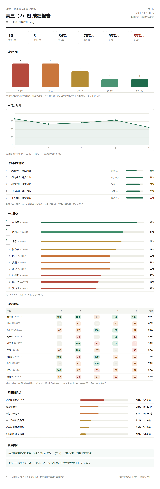

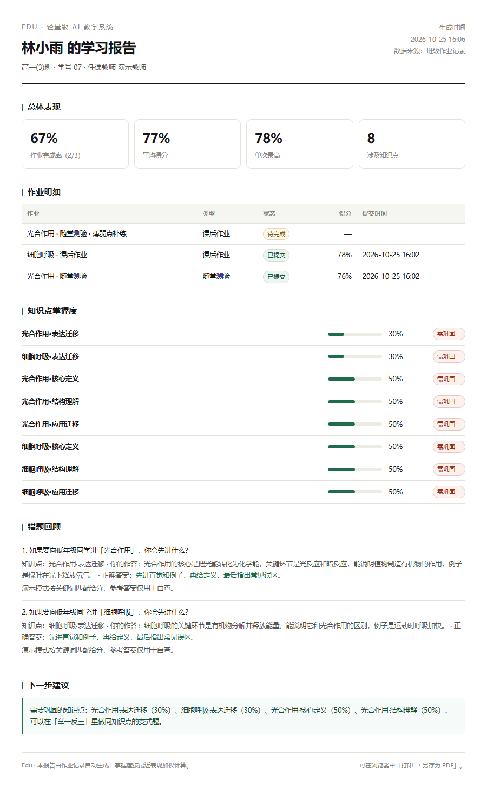

### 学生端怎么用

1. 侧边栏点 **班级**。
2. 用老师导入的**学号 + 密码**登录（初始密码由老师提供；同一学号在多个班时再填班级邀请码）。
   浏览器会记住登录态，下次打开直接进入。
3. 任务按「待完成 / 已完成 / 已截止」分组：
   - 点「开始作答」进入答题页，答完提交；
   - 文件作业点「提交附件」，上传后立刻看到 AI 初评；
   - 已完成的作业可以「查看结果」，在允许的情况下能看到正确答案与解析；
   - 作业还开放时可以「再做一次 / 重新提交」，以最后一次为准。
4. 点「退出班级」可以换账号，已提交的记录不会丢失。

> 老师还没导入名单的班，仍可以用邀请码 + 姓名加入（点登录页下方的「改用邀请码加入」）；一旦导入了名单，邀请码加入会自动关闭。

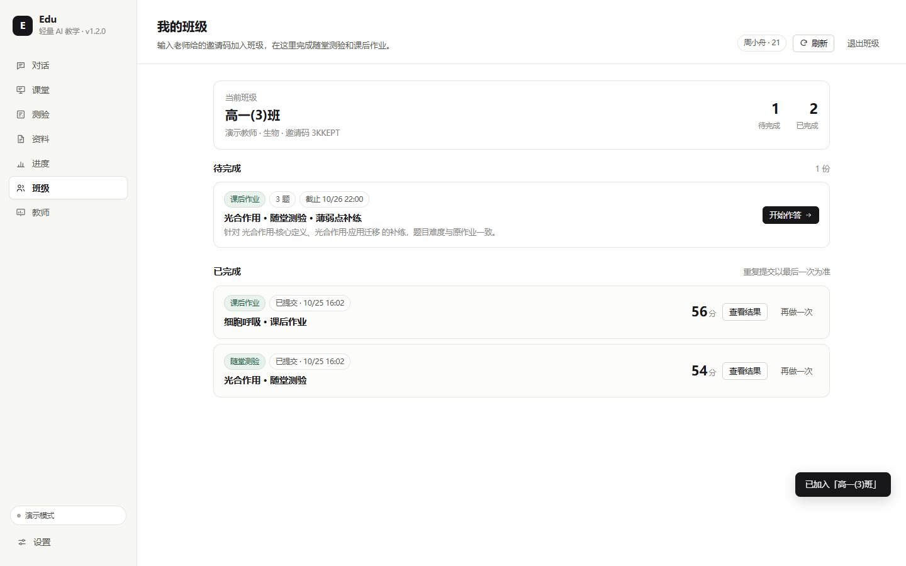

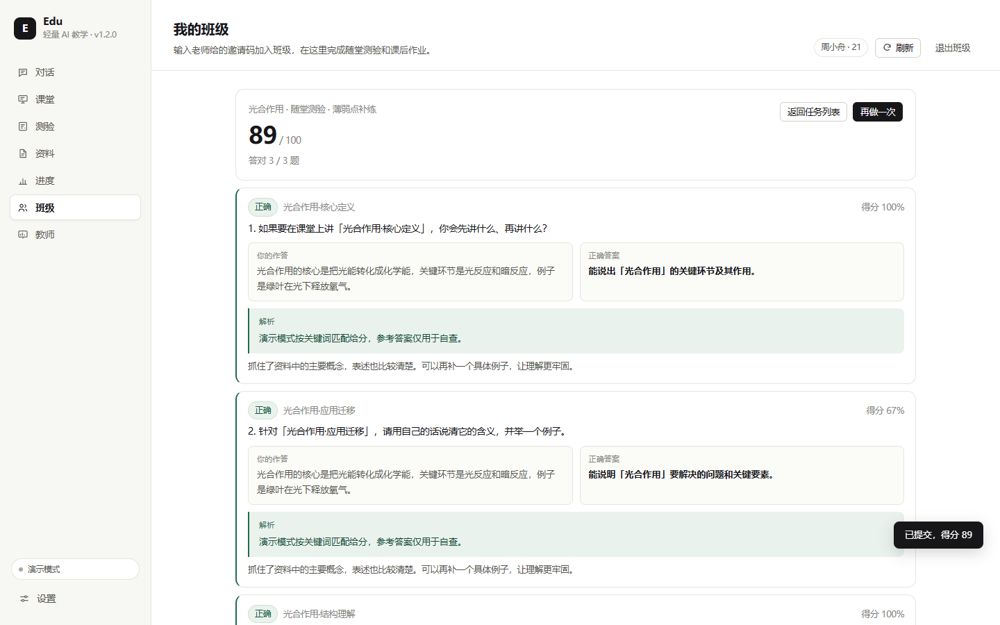

## 文件作业、AI 批改与教师复核（v1.4 新增）

除了在线作答，教师现在可以布置**文件作业**：学生上传 PDF / Word / PPT / 文本 / 图片，
AI 先给初评，教师再复核改分。

### 教师：布置文件作业

「作业 → 布置新作业」里把**作业形式**切成「文件提交」，填写主题、可选评分要点，保存即可。
文件作业不会调用模型出题，发布后学生端立即出现「提交附件」入口。

### 学生：提交文件

在「班级」页点「提交附件」，选择文件（≤20 MB）并可选填说明。提交后：

1. 服务端按扩展名抽取文本（PDF / DOCX / PPTX / TXT / MD）；
2. 调用模型按评分要点批改，返回分数、评语、逐条要点判断；
3. 结果立即回显给学生，同时推送给教师端。

图片或扫描件无法提取文字时会自动标记「待教师批改」，不会假装给了分。
截止前可以重新提交，旧文件会被清理。

### 教师：下载与复核

作业详情页的「提交与批改」会列出每个学生的文件、AI 初评、最终分与状态：

- **下载**：点文件名即可拿到原始附件；
- **改分**：填 0–100 的最终分与评语，保存后学生端立即生效，AI 初评与修改记录都会保留；
- **AI 重批**：换模型或学生重交后可以重新触发一次批改。

CSV / HTML 报告里的分数自动使用最终分，不需要额外设置。

## 名单导入与学号登录（v1.5 新增）

学生不再靠邀请码自助加入，而是由教师导入名单后，用**教务系统学号 + 密码**登录。

### 教师：导入名单

班级详情 →「导入名单」，上传 CSV / TXT 或直接粘贴。列顺序不限，表头可用
`学号`、`姓名`、`密码`（也识别 `学籍号`、`学生姓名`、`初始密码` 等别名）；
没有密码列时按「默认密码」或自动生成 6 位初始密码。

```text
学号,姓名,密码
2024001,张三,zhang123
2024002,李四,li456
```

导入后：

- 已存在的学号会更新姓名并**重置密码**，历史提交记录保留；
- 结果页列出每个学生的初始密码（只显示这一次），可一键复制；
- 「导出名单」下载的 CSV 只含学号 / 姓名 / 密码状态 / 最后登录，不含明文密码；
- 该班的邀请码加入会自动关闭，学生必须用学号登录。

### 学生：学号登录

「班级」页输入学号和密码。同一学号出现在多个班时，再填班级邀请码即可。
忘记密码找老师「重置密码」，系统会生成新的 6 位初始密码。

### 教师：重置密码

学生名单里每行都有「重置密码」，生成的新密码只弹一次，可复制转告学生；
重置后旧密码立即失效。

## 身份与安全边界（v1.5 加固）

- **学生账号**：密码与教师账号同一套 PBKDF2-SHA256（12 万轮）加盐存储；登录用学号 + 密码，
  成功后签发 HMAC 令牌（`data/secret.key`），学生接口、SSE、附件下载都校验令牌。
- **教师会话持久化**：token 的 SHA-256 落盘到存储层的 `sessions`，重启服务不再全体掉线。
- **判分防注入**：学生作答放进围栏并明确声明「只是数据」；出现「忽略要求 / 给满分」等指令、
  或空白答案拿高分时自动降分并标记待复核。
- **CSV 防公式注入**：导出时对 `=` `+` `-` `@` 开头的单元格加 `'` 前缀。
- **上传限额**：文件按 1 MB 分块读取，超限立即中止，不再先读满内存再判断。
- **限流**：生成类接口、登录、上传都有进程内滑动窗口限流（`EDU_RATE_LIMIT` 可调，0 关闭）。
- **读缓存**：JSON 读取按 mtime 缓存，实时刷新不再反复全量读盘。

## 配置模型

Edu 支持任何 **OpenAI 兼容** 的 `/chat/completions` 接口。

在界面左下角点击「设置」，选择预设、填入 Key，点「测试连接」后保存：

| 预设 | Base URL | 模型示例 |
| --- | --- | --- |
| DeepSeek | `https://api.deepseek.com/v1` | `deepseek-chat` |
| OpenAI | `https://api.openai.com/v1` | `gpt-4o-mini` |
| 通义千问 | `https://dashscope.aliyuncs.com/compatible-mode/v1` | `qwen-plus` |
| 智谱 GLM | `https://open.bigmodel.cn/api/paas/v4` | `glm-4-flash` |
| Ollama 本地 | `http://127.0.0.1:11434/v1` | `qwen2.5:7b` |

也可以复制 `.env.example` 为 `.env`，通过环境变量配置：

```dotenv
EDU_BASE_URL=https://api.deepseek.com/v1
EDU_MODEL=deepseek-chat
EDU_API_KEY=sk-...
# 可选：限流，0 关闭
EDU_RATE_LIMIT=120
# 可选：存储后端，默认 sqlite；改成 json 可退回旧的文件存储
EDU_STORE=sqlite
# 可选：数据库位置，默认 data/edu.sqlite3
EDU_DB_PATH=
# 可选：检索模式，默认 hybrid（bm25 / dense / hybrid / hybrid_rerank）
# 没装 fastembed 时自动退回 bm25，不会影响启动
EDU_RETRIEVAL_MODE=hybrid
# 可选：混合检索里向量那一路的 RRF 权重，默认 1.0
EDU_RETRIEVAL_DENSE_WEIGHT=1.0
```

**演示模式**：不填 Key 时自动启用，用本地规则生成示例回答、课堂和测验，不会发起任何外部请求。教师工作台的出题与判分同样走这套逻辑。想回到演示模式，在设置里清除密钥并保存即可。

密钥仅保存在本机 `data/settings.json`（明文）。本项目面向单机或小班演示，**不要直接暴露到公网**。

## 目录结构

```text
edu/
├─ start.bat                 # Windows 一键启动
├─ start.sh                  # macOS / Linux 一键启动
├─ requirements.txt          # Python 依赖（FastAPI + httpx + 解析 / 导出库）
├─ .env.example
├─ samples/                  # 两份可直接上传的示例资料
├─ server/
│  ├─ main.py                # 应用入口、静态资源、端口与浏览器
│  ├─ config.py              # 配置（环境变量 + data/settings.json）
│  ├─ llm.py                 # OpenAI 兼容流式客户端 + 演示模式实现
│  ├─ prompts.py             # 导师、课堂、出题、评分、小组主持人与角色提示词
│  ├─ default_agents.json    # 默认小组角色（运行时可被存储层的 agents 覆盖）
│  ├─ rag.py                 # 分块（450 字 / 100 重叠）+ 分词 + BM25 基线
│  ├─ schemas.py             # 请求模型（含教师 / 学生请求）
│  ├─ store.py               # 存储门面（默认 SQLite，EDU_STORE=json 退回文件）
│  ├─ db.py                  # SQLite 连接、迁移、JSON → SQLite 导入
│  ├─ migrations/            # 版本化 SQL（0001_init.sql …）
│  ├─ observability.py       # 结构化日志、请求追踪 ID、访问日志中间件
│  ├─ api/                   # chat / classroom / materials / ocr / quiz / progress / settings
│  │  ├─ ocr.py              # 拍题识别接口（状态 + 图片转文字）
│  │  ├─ teacher.py          # 教师登录、班级、作业、统计、导出、复核、名单导入
│  │  ├─ student.py          # 学生学号登录、任务、作答、文件提交与回看
│  │  ├─ limits.py           # 进程内限流
│  │  └─ events.py           # SSE 事件流（学生 / 教师）与在线名单快照
│  └─ services/
│     ├─ auth.py             # 教师账号、PBKDF2 密码、持久化 token
│     ├─ identity.py         # 学生 HMAC 令牌
│     ├─ roster.py           # 名单解析、学生密码哈希与初始密码
│     ├─ classes.py          # 班级 / 学生 / 作业 / 提交 / 统计 / 文件提交
│     ├─ grading.py          # 文件作业批改与判分安全边界
│     ├─ uploads.py          # 上传限额、文本抽取、附件落盘
│     ├─ ocr.py              # 拍题识别：图片预处理 + RapidOCR（ONNX）推理
│     ├─ events.py           # 进程内事件总线 + 在线名单
│     ├─ reports.py          # CSV 导出、学生 HTML 报告、班级成绩报告（CSS/SVG 图表）
│     ├─ retrieval.py        # 混合检索：BM25 + fastembed 向量 + RRF 融合 + LLM 重排
│     └─ ...                 # 对话、课堂、多智能体编排、测验、掌握度、资料解析、PPTX 导出
├─ web/
│  ├─ src/
│  │  ├─ views/              # 对话、课堂、测验、资料、进度、班级、教师工作台
│  │  ├─ components/         # 登录、名单导入、作业弹窗、作业详情、批改面板等
│  │  ├─ App.vue / store.js / api.js / realtime.js / styles.css
│  ├─ dist/                  # 已构建的前端（可无 Node 运行）
│  └─ package.json
├─ scripts/
│  ├─ smoke.py               # 学生端端到端冒烟测试
│  ├─ teacher_smoke.py       # 教师工作台端到端冒烟测试（含文件批改）
│  ├─ realtime_smoke.py      # 实时链路冒烟测试（SSE 事件 + 在线名单）
│  ├─ eval_retrieval.py      # 检索 ablation：BM25 / 向量 / RRF / 重排，输出评测报告
│  └─ api_audit.py           # 前端调用与后端 OpenAPI 路由一致性检查
├─ tests/                    # pytest：鉴权、名单导入、导出、判分、文件作业、存储、检索
├─ requirements-dev.txt      # 测试依赖（pytest）
└─ data/                     # 运行时：资料、课堂、测验、进度、账号、班级、作业、提交、附件
```

## 数据与备份

默认存储是 SQLite（`data/edu.sqlite3`，WAL 模式），业务字段整体存在 `items.data` 这一列里，
所以旧代码的读写方式完全不变。`EDU_STORE=json` 可一键退回原来的「一集合一目录」文件存储，
两种后端对外行为一致。

| 位置 | 内容 |
| --- | --- |
| `data/edu.sqlite3` | 全部业务数据（9 个集合 + progress / sessions / agents），写入有事务 |
| `data/backups/` | 备份快照（`python scripts/backup.py`；迁移前也会自动快照） |
| `data/uploads/` | 学生提交的附件（按作业 / 提交分层；删除作业或学生时一并清理） |
| `data/secret.key` | 学生令牌的 HMAC 密钥（首次启动生成，换机请连同 data/ 一起备份） |
| `data/settings.json` | 界面里保存的模型配置（密钥明文） |
| `data/logs/app.log` | 运行日志（含请求追踪 ID，5MB 轮转 3 份） |
| `data/index/` | 资料片段的向量索引（`.npy` + 同名 `.jsonl` 元信息；可随时删除，下次检索时重建） |
| `data/models/` | 向量模型缓存（约 95 MB，首次使用自动下载；`HF_ENDPOINT` 可换成镜像） |
| `data/<集合>/*.json` | 仅 `EDU_STORE=json` 时使用；首次切换到 SQLite 会自动导入并保留原文件 |

集合含义（都存进 `items` 表，按 `collection` 区分）：

| 集合 | 内容 |
| --- | --- |
| `teachers` | 教师账号（用户名、姓名、盐、密码哈希、最后登录时间、角色：owner / lead / teacher） |
| `classes` | 班级（名称、科目、年级、邀请码、是否归档、所属教师、`group_id` 教研组） |
| `students` | 学生档案（姓名、学号、所属班级） |
| `assignments` | 作业（类型、主题、关联的测验 id、截止时间、是否显示解析、是否关闭） |
| `submissions` | 提交记录（学生、得分、逐题结果或文件、AI 初评、教师复核、提交次数、时间） |
| `groups` | 教研组（名称、组长、成员与其加入时间） |

审计记录不进 `items`：SQLite 下写在独立的 `audit` 表（迁移 `0002_audit.sql`），`EDU_STORE=json` 时退化为 `data/audit.jsonl`。

补充说明：

- 提交记录以「作业 + 学生」为 id，所以重复提交是覆盖而不是堆积，`attempts` 会累加。
- 文件作业的最终分 = 教师复核分；教师未复核时使用 AI 初评分，并标记「待复核」。
- 班级作业的判分**不会**写入本机个人学习进度（`progress`），避免多个学生的成绩混在一起；学生个人的测验与练习仍然照常记录。
- 备份：`python scripts/backup.py`（热备份，服务不用停），或直接复制 `data/`。
- 迁移：`python scripts/migrate_json_to_sqlite.py` 先看统计，加 `--apply` 才写入；导入后逐条回读校验。
- 重置：删除 `data/` 会清空所有资料、课堂、账号、班级与成绩；只想重置教师端，清空 `items` 表里的
  `teachers` / `classes` / `students` / `assignments` / `submissions` 即可。下次启动会重新创建 `demo` 账号。

## HTTP API

所有接口以 `/api` 开头，交互式文档在 `/api/docs`。教师接口需要 `Authorization: Bearer <token>`。

### 学生端

| 方法 | 路径 | 说明 |
| --- | --- | --- |
| GET | `/health` | 健康检查、模式、资料/课堂/班级数量 |
| GET / PUT | `/settings` | 读取 / 保存模型配置（密钥只返回掩码） |
| POST | `/settings/test` | 用当前配置发一次最小请求 |
| GET / POST | `/materials` | 资料列表 / 上传（multipart，≤10 MB） |
| DELETE | `/materials/{id}` | 删除资料 |
| GET | `/ocr/status` | 拍题识别是否可用（依赖是否装好）、大小与置信度阈值 |
| POST | `/ocr/extract` | 上传图片（multipart，≤8 MB），返回逐行文字与置信度 |
| POST | `/chat/stream` | 导师对话，SSE |
| POST | `/classroom/generate` | 生成课堂，SSE |
| GET | `/classroom/lessons` | 已保存课堂列表 |
| GET / DELETE | `/classroom/lessons/{id}` | 读取 / 删除课堂 |
| POST | `/classroom/lessons/{id}/quiz` | 用课堂检测页生成可提交测验 |
| GET | `/classroom/lessons/{id}/export/pptx` | 导出教师版 PPTX |
| POST | `/classroom/discuss` | 向 AI 老师提问（多轮），SSE |
| GET / PUT | `/classroom/group/agents` | 读取 / 保存小组配置 |
| POST | `/classroom/group/agents/reset` | 恢复默认小组 |
| POST | `/classroom/group-discuss` | 多智能体讨论，SSE |
| POST | `/quiz/generate` | 生成测验 |
| POST | `/quiz/{id}/submit` | 提交并评分 |
| POST | `/quiz/{id}/similar` | 按薄弱知识点生成相似题 |
| GET / DELETE | `/progress` | 学习进度 / 清空记录 |

### 教师工作台

| 方法 | 路径 | 说明 |
| --- | --- | --- |
| POST | `/teacher/register` | 注册教师账号，返回 token |
| POST | `/teacher/login` | 登录 |
| POST | `/teacher/logout` | 退出（作废当前 token） |
| GET | `/teacher/me` | 当前教师信息 |
| PUT | `/teacher/password` | 修改密码 |
| GET | `/teacher/overview` | 概览统计、待处理作业、薄弱知识点、最近提交 |
| GET / POST | `/teacher/classes` | 班级列表 / 新建班级 |
| GET / PATCH / DELETE | `/teacher/classes/{id}` | 班级详情 / 修改或归档 / 删除 |
| POST | `/teacher/classes/{id}/code` | 重置邀请码 |
| POST | `/teacher/classes/{id}/roster` | 导入学生名单（multipart：文件或粘贴文本） |
| GET | `/teacher/classes/{id}/roster.csv` | 导出名单（学号 / 姓名 / 密码状态 / 最后登录） |
| POST | `/teacher/classes/{id}/students/{sid}/password` | 重置学生登录密码 |
| DELETE | `/teacher/classes/{id}/students/{sid}` | 移出学生 |
| GET | `/teacher/classes/{id}/report.html` | 班级成绩报告（带图表的 HTML） |
| GET | `/teacher/classes/{id}/export.csv` | 班级成绩矩阵 CSV |
| GET / POST | `/teacher/assignments` | 作业列表（可按 `class_id` 过滤）/ 布置作业 |
| GET / PATCH / DELETE | `/teacher/assignments/{id}` | 作业详情（含错题与知识点统计）/ 关闭、重开、改截止 / 删除 |
| POST | `/teacher/assignments/{id}/practice` | 按薄弱知识点生成补练作业 |
| GET | `/teacher/assignments/{id}/export.csv` | 作业明细 CSV |
| GET | `/teacher/students/{sid}/report.html` | 学生个人 HTML 报告 |
| GET / POST | `/teacher/groups` | 我参与的教研组 / 新建教研组 |
| PATCH / DELETE | `/teacher/groups/{id}` | 改组名 / 解散教研组 |
| POST | `/teacher/groups/{id}/members` | 按用户名邀请组员 |
| DELETE | `/teacher/groups/{id}/members/{tid}` | 移除组员 |
| GET | `/teacher/audit` | 最近审计记录（仅组长与部署者） |
| GET | `/teacher/submissions/{sid}` | 单份提交详情（AI 初评、教师复核、文件列表） |
| PATCH | `/teacher/submissions/{sid}` | 教师复核改分（百分制，覆盖最终分并保留记录） |
| POST | `/teacher/submissions/{sid}/regrade-ai` | 重新触发一次 AI 批改 |
| GET | `/teacher/submissions/{sid}/files/{fid}` | 下载学生提交的附件 |
| GET | `/teacher/stream` | 教师端 SSE：班级、作业、提交、学生在线状态（需 Bearer） |
| GET | `/teacher/presence` | 在线名单快照（哪个学生此刻开着班级页） |

### 学生班级

| 方法 | 路径 | 说明 |
| --- | --- | --- |
| POST | `/student/login` | 学号 + 密码登录，返回 `student`、`klass`、`tasks` 与 `token` |
| POST | `/student/join` | 兼容：老师未导入名单时，用邀请码 + 姓名（+ 学号）加入 |
| GET | `/student/tasks` | 任务列表与状态（`student_id` + `token`） |
| POST | `/student/tasks/{id}/start` | 取题（不返回答案）；文件作业返回已提交文件 |
| POST | `/student/tasks/{id}/submit` | 交卷，返回得分与逐题结果 |
| POST | `/student/tasks/{id}/submit-file` | 提交文件作业（multipart，≤20 MB），同步返回 AI 初评 |
| GET | `/student/tasks/{id}/result` | 回看已提交的结果 |
| GET | `/student/submissions/{sid}/files/{fid}` | 下载自己提交的附件（需 `token`） |
| GET | `/student/stream` | 学生端 SSE：订阅自己的任务与班级事件（`student_id` + `token`） |

SSE 事件统一为 `data: {...}`：

- 对话：`meta`（来源、是否演示）→ `delta`（增量文本）→ `done`；失败为 `error`。
- 课堂：`status`（备课阶段）→ `lesson`（完整课堂 JSON）→ `done`；失败为 `error`。
- 讨论：`meta` → `delta` → `done`。
- 小组：`meta`（全部角色、本轮发言人、主持人理由）→ 每位同学 `agent_start` → `delta` → `agent_end` → `done`。

## 设计说明

- **单进程**：FastAPI 同时提供 API 和 `web/dist` 静态资源，`uvicorn` 一个进程即可；前端没有路由，页面切换用响应式状态。
- **流式**：服务端用 `httpx` 转发模型 SSE，前端用 `fetch + ReadableStream` 自行解析，因此「停止生成」可以真正中断请求。
- **存储**：默认 SQLite（WAL，事务写入）；`EDU_STORE=json` 可退回「临时文件 + `os.replace`」的 JSON 文件存储。无后台任务队列。
- **多教师与权限（P2）**：角色分 `owner`（部署者）/ `lead`（教研组长）/ `teacher`；判断集中在 `server/services/perms.py`——读用 `can_view_class`、写用 `can_edit_class`、看分与改分用 `can_view_grades`，API 层统一调用，不散落在业务函数里。首次注册自动成为 owner，组长身份由「是否为某个组的创建者」推导。
- **审计（P2）**：`server/services/audit.py` 只记「谁、何时、对什么、做了什么、结果」，不记学生答案与密码；写失败只打告警，绝不阻断主流程。
- **检索**：按段落分块（约 450 字、100 字重叠——bge 的 512 token 上限定在这里，块再大向量那一路会被截断），中文按二元组、英文按单词建 BM25 索引。检索分三层：BM25 取 20 条、向量（fastembed + `bge-small-zh-v1.5`，ONNX，不用 torch）取 20 条，RRF（k=60，向量权重可调）融合成 10 条，需要时再让模型做一次 listwise 重排取 4 条。`EDU_RETRIEVAL_MODE` 可切 `bm25` / `dense` / `hybrid` / `hybrid_rerank`；没装 fastembed、模型下载失败或离线时自动退回 BM25，检索永不报错。向量索引落在 `data/index/<资料 id>-<摘要>.npy`，内容变了自动重建，旧索引顺手清理。
- **掌握度**：对每个知识点保留最近 5 次成绩，权重从旧到新为 `0.5 / 0.7 / 0.85 / 0.95 / 1.0`；只有 1 次证据时上限 0.5，2 次时上限 0.8，避免“蒙对一题就算掌握”。策略集中在 `server/services/mastery.py`。
- **课堂答疑**：课堂生成一次拿到结构，之后把「当前页 + 最近 10 轮对话」一起送入教师提示词；切换页面时上下文自动更新。
- **小组互动（多智能体）**：角色从存储层的 `agents` 读取；每轮由主持人 Agent 选择 2–3 位发言人并给出发言焦点，后一位能看到前一位刚说的话。没有模型时回退为轮换发言，编排仍是同一套配置。
- **测验与举一反三**：结果逐题返回作答、正确选项、参考答案与解析；「举一反三」把错题知识点作为重点，再生成一组同难度变式题。
- **教师账号**：只依赖标准库。密码 `pbkdf2_hmac('sha256', ..., 120000)` 加盐；token 用 `secrets.token_urlsafe` 生成，12 小时过期；存储层只落 token 的 SHA-256，明文 token 不写盘。
- **班级与作业**：一次作业指向 `quizzes` 集合里的一份题目，学生提交时用同一套判分逻辑（`quiz_service.grade(..., track=False)`），但不写入本机个人进度；提交记录以「作业 + 学生」为 id，天然支持覆盖与提交次数统计。
- **实时推送**：学生进班、交卷、老师布置/关闭/删除作业，写盘成功后都会往进程内事件总线 `server/services/events.py` 发一条「什么变了」的信号（不带业务数据）。`/api/student/stream` 与 `/api/teacher/stream` 用 SSE 把它推给对应的人，前端收到后调用**原有接口**整体重拉，所以统计口径和权限过滤只有一份实现。断线按 800ms → 10s 指数退避重连，每次连上先重拉一次，断线期间错过的事件自然补齐——因此不需要事件持久化，也不需要 `Last-Event-ID` 重放。教师流每 60 秒复核一次 token，过期会收到 `unauthorized` 并回到登录页。
- **在线名单**：学生打开「班级」页即建立 SSE 连接，`Presence` 按连接数计数（多标签页不会误判离线），老师端用 `/api/teacher/presence` 取首屏快照，之后靠 `student_online` / `student_offline` 增量维护。**这个方案依赖单进程**；改成多 worker 或多机部署时，事件总线和在线名单都要换成 Redis（事件名与前端协议不用动）。
- **学生身份**：入班时用本机密钥（`data/secret.key`）签发 `student_id + token`，令牌是无状态 HMAC，所以重启服务、换设备重新加入都能复用；所有学生接口（含 SSE 与附件下载）都校验，避免只知道 id 就能替人交卷。
- **教师会话**：`sessions` 只保存 token 的 SHA-256 与过期时间，磁盘泄露不等于登录态泄露；重启服务后仍然有效。
- **文件作业**：上传按 1 MB 分块读取并累计大小（不再先读满内存）；附件落在 `data/uploads/<作业>/<提交>/`，删除作业、移出学生或重新提交都会清理旧文件；PDF/DOCX/PPTX 文本抽取放在线程池，避免阻塞事件循环。
- **判分安全**：学生内容用 `<<< >>>` 围栏包住并声明「只是数据」，prompt 明确要求忽略其中的指令；结果做范围校验，出现「忽略要求 / 给满分」或空白答案拿高分时强制降分并标记待复核。
- **导出安全**：CSV 对以 `= + - @` 开头的单元格加 `'` 前缀，防止公式注入；HTML 报告继续统一 `html.escape`。
- **拍题识别**：`rapidocr`（ONNX Runtime 后端，约 27MB 模型）+ `pillow` 预处理。选它而不是 PaddleOCR，是因为 Python 3.14 没有 `paddlepaddle` 的 cp314 轮子；选它而不是视觉大模型，是因为图片不出本机。图片先纠正 EXIF 方向、转 RGB、长边压到 1600px 再推理（识别率基本不变，速度提升明显）；逐行返回置信度，低于 0.25 的行丢弃、低于 0.6 的行在前端标灰提示核对。引擎懒加载单例，推理放线程池，不阻塞 SSE；没装依赖时 `/api/ocr/status` 报不可用、`/api/ocr/extract` 返回 503，不影响服务启动。
- **限流与缓存**：生成类、登录、上传接口用进程内滑动窗口限流；`EDU_STORE=json` 时 JSON 读取按 mtime 缓存并返回深拷贝，实时刷新不会反复全量读盘。
- **统计口径**：提交率 = 已提交人数 ÷ 应交人数；题目错误率 = 答错人数 ÷ 已作答人数；知识点错误率同理。未作答的题不计入该题错误率，但整份作业仍按 0 分计入平均分。
- **报告**：不引入模板引擎，`reports.py` 直接拼 HTML（所有用户输入经过 `html.escape`）；CSV 带 UTF-8 BOM，Excel 可直接打开。图表同样不引第三方库——柱状图、排名条、完成率条用 CSS 画，趋势折线用内联 SVG 手算坐标，因此报告是**零外部依赖的单文件**，离线、转发、打印都不变形。HTML 报告内置打印样式，A4 打印或另存 PDF 都不会截断表格。
- **演示模式**：与真实模型走同一套接口，`llm.py` 内部替换为规则生成；课堂/测验的来源、评分方式都会明确标注，不伪装成真实模型输出。
- **视觉**：只用纯色、1px 边框、系统字体和一处克制的绿色强调；错误率用红色进度条与完成率区分；全站没有 `backdrop-filter`、渐变或玻璃质感，移动端断点为 900px。

## 常见问题

**启动后浏览器打不开？**  
看命令行打印的地址；若 8000 被占用，Edu 会自动尝试 8001–8049，以实际输出为准。

**提示 401 / 403？**  
Key 无效或无权限。到「设置」检查 Key，用「测试连接」确认。

**提示 404？**  
Base URL 或模型名不对。多数服务需要以 `/v1` 结尾；Ollama 是 `http://127.0.0.1:11434/v1`。

**PDF 上传后没有内容？**  
扫描件没有文字层。可以先把题目拍照或截图，用资料库的「拍题识别」转成文字再上传；
或者用带文字层的 PDF / 自行转成 Markdown、TXT。

**教师登录提示「登录已过期」？**  
token 有效期 12 小时，过期后重新登录即可，数据没有丢。

**忘记教师密码？**  
删除 `teachers` 集合里的对应账号记录，重启服务会重新创建 `demo` 账号；该账号创建的班级仍保留，但需要用新账号重新建班（或直接改记录里的 `teacher_id`）。

**学生说看不到作业？**  
依次检查：邀请码是否正确、作业是否属于该学生所在班级、作业是否已关闭或过了截止时间。截止后可以在作业详情点「重新开放」。

**页面不用刷新就能更新，是怎么做的？**  
学生「班级」页和教师工作台各维持一条 SSE 长连接（`/api/student/stream`、`/api/teacher/stream`）。写操作成功后会广播一条「什么变了」的信号，前端收到后调用原有接口重拉数据。断线自动重连，重连成功后补拉一次，所以断网恢复也不会丢状态。页头的「实时」绿点表示连接正常；变成「重连中」说明网络或服务端暂时不通。

**学生提交文件失败？**  
先看格式：支持 pdf / docx / pptx / txt / md / png / jpg，单个文件不超过 20 MB。扫描件或图片没有文字层时，系统会标记「待教师批改」而不是自动给分。截止后需要老师在作业详情里「重新开放」。

**学生登录提示「学号或密码不正确」？**  
先确认老师导出/导入的是同一个学号；初始密码区分大小写。可以请老师在该班学生名单里点「重置密码」，拿到新的 6 位密码再试。同号多班时还要填班级邀请码。

**导入名单失败 / 中文乱码？**  
名单用 UTF-8 或 GBK 编码保存为 CSV 即可；从 Excel 直接复制粘贴也可以，列顺序不限，但要有「学号」「姓名」两列。表头缺列、学号带空格或分隔符时会跳过该行并在结果里提示。

**导入名单后还能用邀请码加入吗？**  
不能。一个班只要导入过名单，邀请码加入就会自动关闭，学生必须用学号 + 密码登录；老师仍可以重置邀请码给还没导入名单的班使用。

**升级到 v1.5 后学生要重新登录？**  
v1.5 起学生默认用学号 + 密码登录。之前用邀请码加入的档案仍然保留，但需要老师导入名单（或重置密码）后才能用学号登录；历史成绩不会丢。

**自己改成多进程启动后实时失效？**  
事件总线和在线名单都放在进程内存里，只适用于默认的单进程启动方式。用 `--workers > 1` 或多机部署时，需要把 `server/services/events.py` 换成 Redis pub/sub，否则会出现「A 进程里的写入推不到 B 进程上的连接」。

**两个学生同名怎么办？**  
让学生填上学号。学生档案按「姓名 + 学号」识别，学号不同就是两个人。

**学生换手机/浏览器后要重新加入吗？**  
需要重新输入邀请码和姓名（学号建议一致），加入后会复用原档案并看到之前的成绩。

**演示模式下题目为什么都是简答题？**  
没有模型时无法可靠生成有迷惑性的单选题，所以用简答题 + 关键词评分保证流程完整；配置 Key 后即为单选题 + 模型批改。演示模式的分数区分度也较低，只用于走通流程。

**导出的 CSV 在 Excel 里乱码？**  
文件已带 UTF-8 BOM，正常双击即可。若仍乱码，请用「数据 → 从文本/CSV」并选择 UTF-8。

**学生报告怎么变成 PDF？**  
用浏览器打开导出的 HTML，`Ctrl+P` 选择「另存为 PDF」，页边距选默认即可。

**前端改了不生效？**  
重新构建：`cd web && npm run build`；或开发时用 `npm run dev`（Vite 代理到 8000，后端请固定 `--port 8000`）。

**更新后界面还是旧版？**  
`index.html` 已设置 `no-store`。先按 `Ctrl+F5` 强制刷新；仍看到旧界面就停止旧进程，重新运行 `start.bat`。新版侧边栏底部显示 `v1.5.0`，导航里有「班级」和「教师」。

**数据存在哪里？如何备份/重置？**  
`edu/data/`。备份整个目录即可；删除 `data/` 会清空资料、课堂、测验、进度、教师账号、班级与成绩（设置也会重置）。

**可以把服务放到公网给全班用吗？**  
不建议。当前是单机 / 小班演示：学生身份只靠学号 + 密码 + 邀请码；数据落在本机 `data/edu.sqlite3`，库文件本身不加密。若要多人长期使用，至少需要加反向代理、HTTPS、多教师权限与审计、定期备份。

**首次启动需要联网吗？**  
需要一次。Python 依赖从 PyPI（或清华镜像）安装；前端产物已附带，不需要 Node/npm。

## 验证情况

仓库内提供了 pytest 用例与四份冒烟脚本，覆盖学生端、教师工作台、实时链路与文件批改：

```bash
# 单元 / 接口测试（用临时数据目录，不碰真实 data/，不调用外部模型）
.venv\Scripts\python -m pytest -q

# 先启动服务，再执行
.venv\Scripts\python scripts/smoke.py http://127.0.0.1:8000
.venv\Scripts\python scripts/teacher_smoke.py http://127.0.0.1:8000
.venv\Scripts\python scripts/realtime_smoke.py http://127.0.0.1:8000
.venv\Scripts\python scripts/api_audit.py http://127.0.0.1:8000
```

`pytest` 覆盖：学号登录与令牌鉴权、名单导入/重置密码/多班同号、CSV 公式转义、判分注入降级、文件作业提交/下载/复核/重交、教师会话落盘、上传限额、路径穿越、SQLite 迁移与回退、拍题 OCR（图片预处理与真实推理）、教研组权限矩阵（只读共享 / 越权拒绝）、审计落点与可见性、混合检索（RRF 融合、向量不可用时的降级、索引缓存与重建）。当前 **86 个用例全部通过**。

`teacher_smoke.py` 会依次跑通：教师登录 → 建班 → 两名学生加入 → 布置随堂测验 → 学生作答提交 → 教师查看统计（提交率、未交名单、每题错误率、知识点）→ 文件作业提交 / AI 初评 / 下载 / 复核 → 薄弱点补练 → 导出班级成绩报告 / 班级 CSV / 作业 CSV / 学生报告 → 概览。当前结果全部通过。

`realtime_smoke.py` 会自建一个临时班级并**同时订阅两条 SSE**，验证：学生加入 → 教师流收到 `student_joined`；在线名单包含该学生；老师布置作业 → 学生流收到 `assignment_created`；学生交卷 → 教师流收到 `submission_saved` 且作业详情立即变为已交。跑完自动删除临时班级。

`api_audit.py` 会把 `web/src` 里的接口调用与后端 OpenAPI 路径逐一比对，当前 **58 个调用、0 个缺失**；如果以后改了路由忘了改前端，会直接列出来。

开发过程中已验证：

- 演示模式全流程，以及无 Key 时的引导文案；
- 用本地 OpenAI 兼容 mock 验证真实请求路径：SSE 增量、`reasoning_content` 忽略、课堂/测验 JSON 解析、单选与简答评分；
- 用 mock 验证主持人 Agent 选人：返回「小问 + 小理」及理由，SSE 只输出角色发言、不泄漏规划 JSON；
- 课堂多轮答疑、小组互动、小组配置增删改与恢复默认、举一反三练习、PPTX 导出；
- 教师工作台：注册/登录/改密/退出、班级增删改与归档、邀请码重置、邀请链接自动填码、学生加入与重名复用、作业布置（随堂测验 / 课后作业）、关闭与重开、学生作答与重复提交、错题与知识点统计、薄弱点补练、四种导出（班级成绩报告 HTML、班级 CSV、作业明细 CSV、学生报告 HTML）；
- 文件作业：txt / pdf / docx / pptx 提交、AI 初评、教师下载、教师复核改分、AI 重批、图片转人工；
- 名单与登录：CSV/粘贴导入、初始密码生成与默认密码、重复学号覆盖、多班同号要求邀请码、教师重置密码、导入后邀请码关闭；
- 身份边界：无 token 访问学生接口 401、他人 token 401、其他教师读取/改分 400；
- 权限边界：未登录访问教师接口返回 401；教师只能操作自己的班级与作业；
- 实时链路：学生加入 / 布置作业 / 交卷三类事件双向到达，在线名单随连接建立与断开正确增减，教师 token 过期后流会收到 `unauthorized`；
- 教研组：建组即成为组长、按用户名邀请/移除成员、组员只读查看共享班级与报告、组外教师不可见、普通教师看不到审计、组长与部署者可见；
- 混合检索：真实 bge 模型下「植物怎样把二氧化碳变成糖」命中暗反应片段（融合序第 1）；未装 fastembed / 模型加载失败自动退回 BM25 且接口不报错；`python scripts/eval_retrieval.py` 跑 163 条查询 × 5 组配置，输出 [ablation 报告](docs/eval/results-20261027.md)，服务启动后 `/eval` 可看同内容的 HTML 版；
- 前端 58 个 API 调用与后端 OpenAPI 路径一致性检查通过（`scripts/api_audit.py`，0 个缺失）；
- 拍题识别：真实图片经 `/api/ocr/extract` 返回逐行文字（`EDU OCR TEST 2026` 识别正确，置信度 0.986，单张 1.4 秒），拖拽弹窗与状态接口在浏览器中验证通过；
- `index.html` 已带 `no-store`，侧边栏显示版本号 `v1.5.0`；
- PDF、DOCX、Markdown 上传与分块；
- 401 时返回可读错误，而不是堆栈；
- 桌面 1440×900 与移动端 390×844 的主要页面（截图见 `docs/`）。

## 致谢与许可

Edu 的教学模型与交互灵感来自两个优秀的开源项目：

- [HKUDS/DeepTutor](https://github.com/HKUDS/DeepTutor)（Apache-2.0）：个性化辅导、知识库检索、掌握度与学习路径。
- [THU-MAIC/OpenMAIC](https://github.com/THU-MAIC/OpenMAIC)（MIT）：一键课堂生成、多智能体课堂、幻灯片与测验编排。

本仓库代码为独立实现，以 MIT 许可证发布，详见 [LICENSE](LICENSE)。
