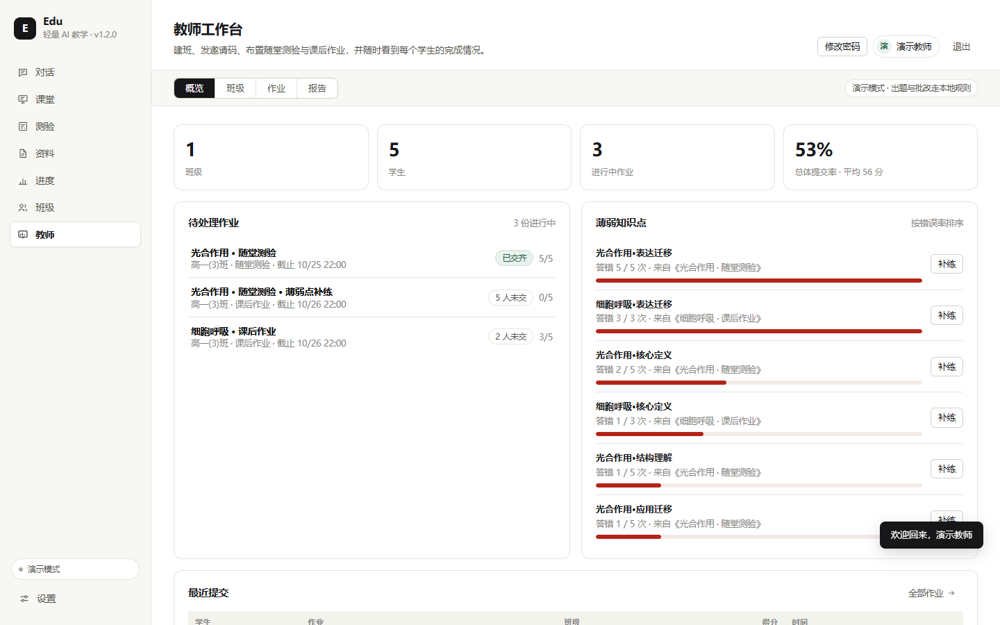

# Edu · 轻量级 AI 教学服务

面向中小学课堂的**本地化 AI 教学应用**。学生上传讲义、向 AI 导师提问、生成课堂、做随堂测验，并看到每个知识点的掌握度；教师建班、导入名单、布置在线测验或文件作业，AI 出题与初评，教师复核改分后导出学情报告。

单进程运行，**不需要数据库服务、不需要向量库、不需要独立的前端服务器**。数据落在一个 `data/edu.sqlite3` 文件里，Windows 下双击 `start.bat` 即可使用。



> 截图拍摄于统一登录改版之前，登录入口请以实际界面为准（见 [统一登录](#2-统一登录)）。

---

## 目录

- [它是什么](#1-它是什么)
- [统一登录](#2-统一登录)
- [功能一览](#3-功能一览)
- [快速开始](#4-快速开始)
- [配置](#5-配置)
- [部署](#6-部署)
- [目录结构](#7-目录结构)
- [HTTP API](#8-http-api)
- [测试与自检](#9-测试与自检)
- [数据与备份](#10-数据与备份)
- [设计取舍](#11-设计取舍)
- [常见问题](#12-常见问题)
- [相关文档](#相关文档)

---

## 1. 它是什么

| 项 | 内容 |
| --- | --- |
| 形态 | 单进程 Web 应用：FastAPI 后端 + Vue 3 前端（同一端口） |
| 技术栈 | Python 3.10+ / FastAPI / SQLite；Vue 3 + 原生 CSS，无 UI 框架 |
| 运行依赖 | 一个 Python 解释器。无需 Node、无需数据库服务、无需 Redis |
| 模型接入 | 任意 OpenAI 兼容接口（默认 DeepSeek），留空则进入**演示模式** |
| 数据 | `data/edu.sqlite3`（`EDU_STORE=json` 可退回文件存储） |
| 许可 | MIT |

**设计来源**：教学模型与交互范式参考了 DeepTutor（个性化辅导、掌握度）与 OpenMAIC（课堂生成、多智能体讨论），代码用 Python + Vue3 独立重写，仓库不含上游代码。

---

## 2. 统一登录

学生和教师**共用一个登录页**，不选身份，由输入决定：

| 场景 | 输入 | 判定 |
| --- | --- | --- |
| 登录 | 纯数字账号 + 密码 | 学生（学号），进入「班级」 |
| 登录 | 含字母/符号的账号 + 密码 | 教师（用户名），进入「教师」工作台 |
| 注册 | 填了班级邀请码 | 学生，加入该班级 |
| 注册 | 邀请码留空 | 创建教师账号 |

判定规则落在服务端 `POST /api/auth/login`：先按用户名查教师，再按学号查未归档班级的名单，命中哪个按哪个校验密码；两者都命中时以密码正确的一方为准。

几条配套约束：

- **教师用户名禁止纯数字**，让「纯数字 = 学号」成为可依赖的硬规则，前端才能实时显示识别结果。
- 同一个学号在多个班时，登录页可展开「填班级邀请码」再登录。
- 一个浏览器同时只保留一种身份，登录会清掉另一种会话。
- 侧栏导航按身份渲染：未登录只有「登录」；学生登录后出现「班级」；教师登录后出现「教师」。

> 旧的 `/api/teacher/login`、`/api/student/login` 仍然保留，供脚本与测试使用。

---

## 3. 功能一览

### 学生端

| 页面 | 能力 |
| --- | --- |
| AI 导师 | 流式对话；上传讲义后基于检索回答并标注出处；「引导 / 讲解」两种模式 |
| 资料库 | 上传 md / pdf / docx / pptx / txt，自动解析、分块、建索引 |
| 课堂 | 一键生成「开场 → 讲解 → 讨论 → 检测 → 回顾」的课堂；逐页追问；导出 PPTX；小组多智能体讨论 |
| 随堂测验 | 生成题目、在线作答、逐题解析、举一反三变式练习 |
| 学习进度 | 知识点掌握度、学习事件时间线、下一步建议 |
| 我的班级 | 学号登录后查看作业与测验任务、提交（在线作答或上传文件）、查看成绩与学习轨迹 |

### 教师端

| 模块 | 能力 |
| --- | --- |
| 账号 | 注册 / 登录 / 改密；首位注册者为 owner，可建教研组并管理成员 |
| 班级 | 建班、6 位邀请码、刷新邀请码、归档、删除 |
| 名单 | 导入 CSV/文本名单，自动生成初始密码；重置密码；导出名单 CSV |
| 作业 | 按主题生成题目，或布置文件提交作业；可设截止时间、是否交卷后显示答案 |
| 题库 | 题目沉淀与复用；AI 生成待审题，教师审核入库 |
| 批改 | 文件作业 AI 初评（评分要点逐条对照），教师复核改分、可重跑 AI |
| 统计 | 提交率、未交名单、每题错误率、知识点错误率，支持一键补练 |
| 导出 | 班级成绩 CSV、作业明细 CSV、班级 HTML 报告、学生个人 HTML 报告 |
| 实时 | SSE 推送：学生加入、交卷、作业发布即时到达对端 |

### 平台能力

- **混合检索**：BM25 + 向量（`BAAI/bge-small-zh-v1.5`）+ RRF 融合，可选 LLM 重排；没装 `fastembed` 自动退回 BM25。
- **掌握度模型**：近期表现加权，证据不足时给置信上限，避免一两道题就判定「已掌握」。
- **存储双后端**：SQLite（默认）与 JSON 文件，同一套接口，`scripts/bench_store.py` 可对比读路径耗时。
- **限流**：生成、登录、上传接口按 IP 每分钟限流，`EDU_RATE_LIMIT=0` 可关闭。
- **可观测性**：请求日志落盘、慢请求告警、审计日志。
- **拍题 OCR**：可选依赖（onnxruntime + rapidocr），未安装时接口返回 503，其余功能不受影响。

---

## 4. 快速开始

### Windows

```bat
:: 双击 start.bat 即可。脚本会自动建 .venv、装依赖、启动服务并打开浏览器。
```

### macOS / Linux

```bash
bash start.sh
```

### 手动启动

```bash
python -m server.main --port 8000
```

可用参数：`--host`、`--port`（默认 0，自动选 8000 起第一个空闲端口）、`--no-browser`、`--reload`。

### 没有 API Key 也能跑

不配置 `EDU_API_KEY` 时进入**演示模式**：不调用任何外部模型，出题、批改、课堂生成走内置规则，界面完整可用，适合先看效果。配置 Key 后自动切换为真实调用，也可以在界面「设置」里填，配置会写进 `data/settings.json`。

### 想看有数据的界面

```bash
# 把脱敏的演示数据拷进数据目录，再启动
cp -r samples/demo-data/* data/
```

演示数据包含教师、班级、学生、作业、提交与学习记录，见 `samples/demo-data/README.md`。

---

## 5. 配置

优先级：`data/settings.json`（界面保存）> 环境变量 / `.env` > 内置默认值。复制 `.env.example` 为 `.env` 后生效。

| 变量 | 默认 | 说明 |
| --- | --- | --- |
| `EDU_BASE_URL` | `https://api.deepseek.com/v1` | OpenAI 兼容接口地址，通常以 `/v1` 结尾 |
| `EDU_MODEL` | `deepseek-chat` | 模型名 |
| `EDU_API_KEY` | 空 | 留空 = 演示模式 |
| `EDU_HOST` | `127.0.0.1` | 监听地址，对外提供服务用 `0.0.0.0` |
| `EDU_PORT` | `0` | 0 表示自动选 8000 起第一个空闲端口 |
| `EDU_OPEN_BROWSER` | `1` | 启动后是否自动打开浏览器 |
| `EDU_DATA_DIR` | `./data` | 数据目录（数据库、索引、日志都在里面） |
| `EDU_STORE` | `sqlite` | 存储后端，`json` 可退回文件存储 |
| `EDU_DB_PATH` | `data/edu.sqlite3` | 数据库文件位置 |
| `EDU_AUTO_IMPORT` | `1` | 首次启动时把旧的 JSON 数据自动导入 SQLite |
| `EDU_RATE_LIMIT` | `120` | 生成/登录/上传接口每分钟每 IP 上限，`0` 关闭 |
| `EDU_RETRIEVAL_MODE` | `hybrid` | `bm25` / `dense` / `hybrid` / `hybrid_rerank` |
| `EDU_RETRIEVAL_DENSE_WEIGHT` | `1.0` | RRF 里向量那一路的权重 |
| `EDU_EMBED_MODEL` | `BAAI/bge-small-zh-v1.5` | 向量模型 |
| `EDU_MODEL_CACHE` | `data/models` | 模型缓存目录 |
| `EDU_LOG_DIR` / `EDU_LOG_LEVEL` | `data/logs` / `INFO` | 日志位置与级别 |
| `EDU_SLOW_MS` | `1000` | 超过该耗时的请求打 WARNING |

国内下载向量模型慢时，可设 `HF_ENDPOINT=https://hf-mirror.com`。

---

## 6. 部署

三种方式，按机器配置选。

### 方式一：Docker（推荐，2 GB 内存以上）

```bash
bash deploy.sh                      # 装 Docker → 生成 .env → 构建 → 起服务 → 健康检查
bash deploy.sh --domain edu.x.cn    # 额外拉起 Caddy，自动申请 HTTPS
bash deploy.sh update|logs|status|restart|backup|down
```

适用 Ubuntu 22.04/24.04、Debian 12。也可以直接用 compose：

```bash
docker compose up -d --build
```

### 方式二：低配服务器（1–2 GB 内存，不用 Docker）

```bash
bash deploy-slim.sh                 # 加 swap → 建 venv → 装精简依赖 → systemd 常驻
bash deploy-slim.sh status|logs|restart|down|uninstall
```

内存占用约 250 MB（Docker 版约 800 MB）。代价：拍题 OCR 返回 503，检索退回 BM25。前端直接用仓库里的 `web/dist`，不需要 Node。

### 方式三：手动

```bash
python -m pip install -r requirements.txt   # 或 requirements-slim.txt
python -m server.main --host 0.0.0.0 --port 8000
```

Nginx 反向代理示例见 `deploy/nginx.conf.example`，systemd 单元见 `deploy/edu.service`。

### 一条硬约束

**只能单进程运行**。SSE 事件总线、在线名单、限流计数都在进程内存里，开多个 worker 会互相看不到对方的事件。需要横向扩展得先把这三样换成外部中间件。

---

## 7. 目录结构

```
edu/
├── server/                 后端
│   ├── main.py             应用入口、静态托管、启动参数
│   ├── config.py           配置（settings.json / .env / 默认值）
│   ├── store.py            存储门面（SQLite / JSON）
│   ├── db.py               SQLite 连接与迁移
│   ├── llm.py              模型调用封装（含演示模式）
│   ├── rag.py              检索门面
│   ├── prompts.py          提示词
│   ├── schemas.py          Pydantic 请求/响应模型
│   ├── api/                HTTP 路由
│   │   ├── auth.py         统一登录 / 注册
│   │   ├── chat.py         对话（SSE）
│   │   ├── classroom.py    课堂生成、答疑、PPTX 导出
│   │   ├── quiz.py         出题、判分、变式练习
│   │   ├── materials.py    资料上传与解析
│   │   ├── progress.py     掌握度与事件流
│   │   ├── student.py      学生端任务与提交
│   │   ├── teacher.py      教师工作台
│   │   ├── events.py       SSE 事件流
│   │   ├── ocr.py          拍题识别
│   │   ├── settings.py     模型设置
│   │   └── limits.py       限流
│   └── services/           业务逻辑（班级、批改、掌握度、检索、报告……）
├── web/                    前端（Vue 3 + Vite）
│   ├── src/views/          对话 / 课堂 / 测验 / 资料 / 进度 / 班级 / 教师
│   ├── src/components/     AuthGate（统一登录）、各类对话框
│   ├── src/styles.css      全站样式（纯色 + 细边框，无渐变/模糊）
│   └── dist/               构建产物，后端直接托管
├── tests/                  pytest 用例
├── scripts/                运维与评测脚本
├── samples/                示例讲义 + 脱敏演示数据
├── docs/                   接口、部署、需求、评审文档与截图
├── deploy/                 nginx / systemd 示例
├── start.bat / start.sh    本地一键启动
├── deploy.sh               Docker 一键部署
└── deploy-slim.sh          低配机器一键部署
```

---

## 8. HTTP API

Base URL 为 `http://<host>:<port>/api`。交互式文档在 `/api/docs`（Swagger UI），完整说明见 [`docs/API.md`](docs/API.md)。

| 分组 | 代表接口 |
| --- | --- |
| 统一登录 | `POST /auth/login`、`POST /auth/register` |
| 对话 | `POST /chat/stream`（SSE） |
| 课堂 | `POST /classroom/generate`、`POST /classroom/discuss`、`POST /classroom/group-discuss`、`GET /classroom/lessons/{id}/export/pptx` |
| 测验 | `POST /quiz/generate`、`POST /quiz/{id}/submit`、`POST /quiz/{id}/similar` |
| 资料 | `GET/POST /materials`、`DELETE /materials/{id}` |
| 进度 | `GET /progress`、`DELETE /progress` |
| 学生端 | `GET /student/tasks`、`POST /student/tasks/{id}/submit`、`POST /student/tasks/{id}/submit-file`、`GET /student/timeline` |
| 教师端 | `/teacher/classes`、`/teacher/assignments`、`/teacher/submissions`、`/teacher/questions`、`/teacher/groups`、`/teacher/audit` |
| 实时 | `GET /student/stream`、`GET /teacher/stream`、`GET /teacher/presence`（SSE） |
| 其他 | `GET /health`、`GET/PUT /settings`、`GET /ocr/status` |

鉴权：教师用 `Authorization: Bearer <token>`；学生用 `student_id` + `token`（JSON body、query 或 `X-Student-Token` 头）。

---

## 9. 测试与自检

```bash
# 单元 / 接口测试：用临时数据目录，不碰真实 data/，不调用外部模型
python -m pytest -q
```

`tests/` 下 18 个测试文件、125 个用例，覆盖学生认证、名单导入、文件提交、批改护栏、权限、审计、SQLite 存储、检索、报告导出、部署脚本等。

> 用 `requirements-slim.txt` 安装的环境会缺 `numpy` 与 OCR 运行时，`tests/test_ocr.py` 与 `tests/test_retrieval.py` 中依赖它们的少数用例会失败，属预期。

服务启动后可跑冒烟脚本：

```bash
python scripts/smoke.py            # 资料 → 对话 → 课堂 → 测验 → 进度
python scripts/teacher_smoke.py    # 登录 → 建班 → 学生加入 → 布置 → 提交 → 批改 → 导出
python scripts/realtime_smoke.py   # SSE 事件是否真的推到了对端
python scripts/api_audit.py        # 前端调用与后端路由的一致性检查
```

评测与运维脚本：`scripts/eval_retrieval.py`（检索 ablation）、`scripts/bench_store.py`（存储后端基准）、`scripts/backup.py`（SQLite 热备份）、`scripts/migrate_json_to_sqlite.py`（数据迁移）。

---

## 10. 数据与备份

所有状态都在 `data/` 下：

```
data/
├── edu.sqlite3      主数据库（教师、班级、学生、作业、提交、题库、会话）
├── settings.json    界面里保存的模型配置
├── index/           检索索引
├── models/          向量模型缓存
├── logs/            运行日志
└── secret.key       学生身份令牌的签名密钥
```

- **备份**：`python scripts/backup.py`（走 SQLite backup API，服务运行中也安全）。Docker 部署用 `bash deploy.sh backup`，或直接打包命名卷 `edu-data`。
- **`data/` 不进版本库**：里面有明文 API Key、会话令牌与学生个人信息，`.gitignore` 已排除，不要手动提交。
- **重置**：停服务后删除 `data/edu.sqlite3` 即可（会连同账号一起清空）。

---

## 11. 设计取舍

- **单进程而不是微服务**：目标场景是一台校内机器、几十个班，单进程省掉了所有中间件。代价是不能开多 worker（见 [部署](#6-部署)）。
- **SQLite 而不是 Postgres**：一个文件即全部状态，备份就是拷文件。数据量到十万级提交仍够用。
- **演示模式是一等公民**：没有 Key 也能完整体验流程，方便评审与教学演示，也避免了「必须先申请 API」的门槛。
- **检索默认混合而不是纯向量**：中文短文本上 BM25 的召回往往比向量更稳，RRF 融合后明显优于单路，`scripts/eval_retrieval.py` 可复现这组对比。
- **前端不用 UI 框架**：样式表三千多行，纯色与细边框，没有渐变、模糊和玻璃质感，加载快、改起来直白。

---

## 12. 常见问题

**Q：启动后浏览器打不开 / 端口被占？**
端口默认 0，会自动找 8000 起第一个空闲端口，实际地址看控制台输出。也可以 `--port 8123` 指定。

**Q：界面显示「演示模式」？**
没配置 API Key。在「设置」里填 Base URL / 模型 / Key，或写进 `.env` 的 `EDU_API_KEY`。

**Q：学生登录提示「学号或密码不正确」？**
确认教师已在班级里导入名单并设置了密码；如果同一个学号在多个班，登录页展开「填班级邀请码」再登录。

**Q：教师注册提示「用户名不能是纯数字」？**
统一登录靠「纯数字 = 学号」区分身份，教师用户名需至少包含一个字母。

**Q：忘记教师密码？**
本地部署可直接改 `data/edu.sqlite3` 里的 `teachers` 表，或删库重建。没有找回流程。

**Q：拍题识别返回 503？**
没装 OCR 依赖。`pip install onnxruntime rapidocr` 后重启；低配机器用 `deploy-slim.sh` 部署时本就没有这两个包。

---

## 相关文档

| 文档 | 内容 |
| --- | --- |
| [`docs/API.md`](docs/API.md) | 完整接口说明（鉴权、参数、错误码） |
| [`docs/DEPLOYMENT.md`](docs/DEPLOYMENT.md) | 打包与部署细节 |
| [`docs/REQUIREMENTS.md`](docs/REQUIREMENTS.md) | 需求文档 |
| [`docs/PROJECT_BRIEF.md`](docs/PROJECT_BRIEF.md) | 一页纸项目速览 |
| [`docs/REVIEW.md`](docs/REVIEW.md) | 代码评审记录 |
| [`samples/demo-data/README.md`](samples/demo-data/README.md) | 演示数据说明 |

## 许可

[MIT](LICENSE)
